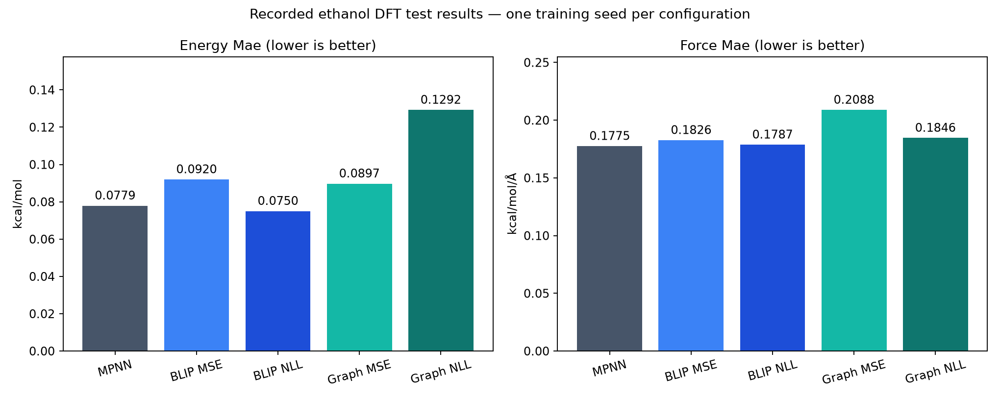
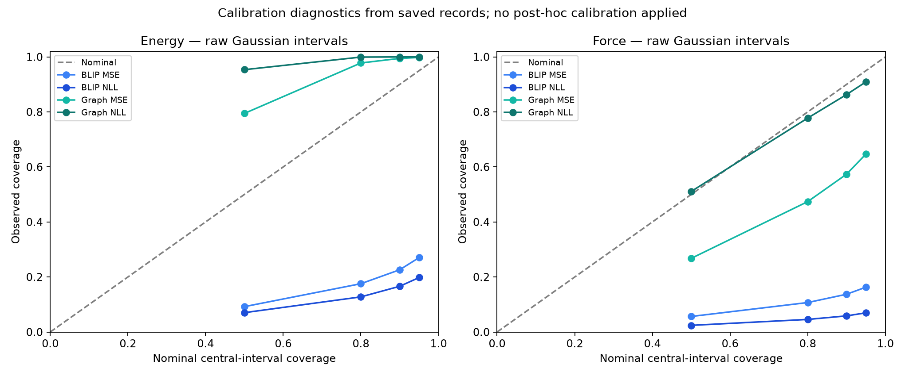

# Technical Report — Phase 3 Evaluation Draft
Author: Dongxiao Wu. Updated: 16 November 2026.

## Current review and evidence scope

This report extends Alex Tanui's first-pass SCRUM-36 analysis with a review of
`alex@cb949a5cb472e20dff00c33f8174f604c9c10cef`. The official headline pair is
**BLIP NLL versus Graph NLL**, following the 12 November SCRUM-40 resolution:
both use four training MC draws and 20 NLL warmup epochs. Graph base remains a
secondary, training-protocol-mismatched comparison. Matching these hooks is not
proof that capacity, variance floors, training code, and every selection detail match.

The matched pair shows a trade-off: Graph NLL energy MAE is 72.3% higher and force
MAE 3.3% higher than BLIP NLL, while raw energy/force ECE is lower. Graph NLL does
not win on point accuracy. Small force Spearman differences do not establish a
reliable ranking advantage from one run.

The 14 November upstream rescore blocks reproduce the recorded accuracy/benchmark
metrics within maximum relative differences of 7.748e-10 (BLIP NLL), 1.374e-10
(Graph base), and 4.555e-11 (Graph NLL). Some generated Markdown still says
"not re-scored" and is stale. These are upstream recorded checks, not new local
inference. The scoring records disclose a dirty tree and evaluator hash; training
replication and complete calibration reproducibility are separate questions.

The raw tables below preserve the 15 November analysis of snapshot
`75dc38f5005b2e9821b4c2ab09e6ab4cd58a5da7`. BLIP MSE is **historical context only**:
the newer upstream policy excludes it from official comparisons pending its clean
retrain. Its earlier snapshot metadata must not be used to override that exclusion.
No model was retrained and no experiment result was overwritten for this review.

The descriptive analysis is complete; inferential analysis still requires paired
frame-level predictions and replicated training. No statistical significance is claimed.

## Comparability audit
All five records use ethanol DFT and the same test fingerprint, representing 55,509
configurations with nine atoms each. The exact 10,000 training IDs and 5,000 validation IDs
match across all five runs, as do their recorded hashes. Data and training configuration
blocks match. Training seed is 42; scoring seed is 0; evaluation batch size is 32.
All stochastic models use 20 Monte Carlo draws. These draws are not independent training
replications. The deterministic record has no uncertainty estimates; N/A must not be
interpreted as zero ECE.

Energy errors refer to total energy in kcal/mol; force errors refer to Cartesian
components in kcal/mol/Angstrom. Test fingerprints are recorded evidence, not independently
recomputed from raw trajectories in this analysis. There are 1,498,743 force components,
but they are not 1,498,743 independent statistical observations.

The common configuration does NOT make this a controlled one-factor causal ablation.
Model sizes differ (MPNN 384,897; BLIP 740,953; Graph 385,925 parameters). MSE and NLL
training differ; NLL uses four training draws and 20 warmup epochs, while MSE variants
use one draw. Model-specific variance floors differ. Checkpoint-selection descriptions
and training code revisions also differ: the MPNN is from 755d57f, BLIP MSE/NLL and
Graph MSE from 1eaea76, and Graph NLL from c9502b2. The earlier snapshot records clean working trees; the newer upstream policy
nonetheless excludes BLIP MSE pending retraining, so it is not an official comparator. The MPNN's older selection wording does not prove identical selection
semantics; a common-code rerun would strengthen attribution.

## Point prediction results
| Model | Energy MAE | Energy RMSE | Force MAE | Force RMSE |
|---|---|---|---|---|
| MPNN | 0.0779 | 0.0962 | 0.1775 | 0.2774 |
| BLIP MSE | 0.0920 | 0.1120 | 0.1826 | 0.2828 |
| BLIP NLL | 0.0750 | 0.0943 | 0.1787 | 0.2788 |
| Graph MSE | 0.0897 | 0.1126 | 0.2088 | 0.3264 |
| Graph NLL | 0.1292 | 0.1612 | 0.1846 | 0.2919 |

Lower error is better. BLIP NLL has the lowest recorded energy MAE/RMSE; the deterministic
MPNN has the lowest recorded force MAE/RMSE. These rankings describe these checkpoints only.

### Where Phase 3 does not beat BLIP
- Graph MSE versus BLIP MSE: energy MAE is 2.45% lower, but energy RMSE is 0.52% higher,
  force MAE 14.35% higher and force RMSE 15.40% higher. A lower energy MAE alone does not
  establish overall improvement.
- Graph MSE versus BLIP NLL: energy MAE is 19.63% higher and force MAE 16.86% higher.
- Graph NLL versus BLIP NLL: energy MAE is 72.31% higher and force MAE 3.28% higher.
  Both RMSE values are also higher (70.91% energy and 4.69% force).
- Graph NLL versus BLIP MSE: energy MAE is 40.51% higher and force MAE 1.07% higher.
- Relative to deterministic MPNN, both Phase 3 variants have higher energy and force errors.

Percentages use (Phase 3 - comparator) / comparator * 100, with positive values meaning
higher error. Absolute differences and all four error metrics are provided in
phase3_differences.csv. No significance is implied by these percentages.

## Raw uncertainty results
| Model | Energy ECE | Force ECE | Energy Spearman | Force Spearman |
|---|---|---|---|---|
| MPNN | N/A | N/A | N/A | N/A |
| BLIP MSE | 0.5964 | 0.6715 | -0.0025 | 0.2641 |
| BLIP NLL | 0.6470 | 0.7379 | 0.0190 | 0.2836 |
| Graph MSE | 0.1538 | 0.2969 | 0.0021 | 0.2622 |
| Graph NLL | 0.2007 | 0.0277 | 0.0013 | 0.2948 |

ECE is the equal-weight mean absolute difference between observed and nominal coverage
at 50%, 80%, 90% and 95%, under Normal(mean, variance) central intervals. The eight
energy/force ECE values were independently recomputed from the saved coverage fractions.
Spearman correlates predicted standard deviation with absolute error: per frame for energy,
and pooled Cartesian components for forces. Spearman values are copied from source records;
they cannot be independently recomputed without paired prediction arrays.

| Model | Energy coverage @90% | Force coverage @90% | Mean energy std | Mean force std |
|---|---|---|---|---|
| MPNN | N/A | N/A | N/A | N/A |
| BLIP MSE | 0.2263 | 0.1373 | 0.0231 | 0.0206 |
| BLIP NLL | 0.1662 | 0.0586 | 0.0122 | 0.0087 |
| Graph MSE | 0.9946 | 0.5737 | 0.2143 | 0.1137 |
| Graph NLL | 0.9999 | 0.8631 | 0.4969 | 0.2107 |

Coverage values are fractions, not percentages. Mean standard deviations have the same
units as the corresponding energy/force errors. Under these Gaussian intervals, mean
width at a fixed nominal level is proportional to mean standard deviation. Better coverage
must therefore be considered together with interval sharpness.

Graph variants have lower ECE than both BLIP variants in these records. Graph NLL is
especially better on force ECE (0.0277 versus 0.7379 for BLIP NLL), and its observed
force coverage at nominal 90% is 86.31%, versus 5.86% for BLIP NLL. It still undercovers.

Graph NLL energy intervals cover 99.99% at nominal 90%, and Graph MSE covers 99.46%.
This is overcoverage, not evidence of perfectly calibrated predictions. Graph NLL has
worse energy ECE than Graph MSE (0.2007 versus 0.1538) and substantially larger mean
energy standard deviation (0.4969 versus 0.2143).

Energy uncertainty-error correlations are near zero for every stochastic variant.
Graph MSE force Spearman (0.2622) is below both BLIP variants; Graph NLL force Spearman
(0.2948) exceeds BLIP NLL (0.2836), but the small observed gap has no significance
assessment. The results do not support a blanket statement that Phase 3 is better.

## Statistical interpretation and remaining work
Only one trained checkpoint per configuration is available in the selected records.
Aggregated MAE/RMSE/ECE values do not contain the joint per-frame error distribution,
so valid paired confidence intervals or p-values cannot be reconstructed from them.
A nominally large frame/component count does not resolve this problem.

Recommended follow-up, to be agreed before additional testing:
1. Obtain frozen, aligned exports for all five models: Gold ID, original trajectory ID
   and source-frame/time mapping, E_ref/E_pred, F_ref/F_pred, and E_var/F_var for stochastic
   models. Record checkpoint hash, source revision, units and MC seed/count.
2. Verify identical frame IDs/references and recompute the published metrics first.
   A checkpoint is not required if these audited exports already exist.
3. Compute paired per-frame absolute-energy errors and per-frame mean absolute force
   component errors. Keep all atoms/components of a frame together.
4. If suitable trajectory provenance is available, use paired trajectory/block resampling,
   applying the same sampled blocks to all models. Choose block lengths using training-only
   dependence diagnostics or physical reasoning; report sensitivity across predeclared lengths.
   Do not randomly bootstrap individual Cartesian components.
5. Block bootstrap is not automatically valid for nonstationary trajectories; assess stationarity,
   effective independent blocks and trajectory boundaries first. If unsuitable, restrict conclusions
   to descriptive block-wise results or obtain independent trajectories.
6. Repeat training with multiple predeclared seeds and a common code/protocol to measure
   training variability. Seed 42 used across different model architectures does not imply
   identical initialization. Do not treat MC draws as extra training seeds.
7. Predeclare primary comparisons/metrics and any multiple-testing correction before
   significance testing. These tests will remain exploratory because the test results
   have already informed discussion.

No confidence intervals or p-values have been fabricated. Training times and inference
times are preserved in the CSV as source-reported context; no speed-up claim is made
without a dedicated common-hardware benchmark.

## Findings for the technical report
Moving stochasticity into graph representations improved raw interval calibration relative
to BLIP in these recorded ethanol experiments, but did not deliver a uniform accuracy gain.
In particular, both Phase 3 variants had larger energy and force MAE than BLIP NLL.
The NLL graph variant substantially improved force coverage compared with BLIP NLL while
retaining severe energy overcoverage and weak energy uncertainty ranking. The evidence
therefore indicates a trade-off between point accuracy and uncertainty behavior, rather
than an overall winner. Replicated training and dependence-aware paired analysis are
needed before generalizing these findings.

## Reproduction and evidence
From the repository root:

    .\.venv\Scripts\python.exe -B docs/dongxiao_scrum36/analyze.py

The script verifies pinned source hashes, ID consistency, metric conventions, and ECE
arithmetic, then regenerates only its own results directory. It does not touch model
checkpoints, Gold arrays, existing team result files, or Git branches.
See source_manifest.json for all source URLs. Generated outputs:
comparison.csv, phase3_differences.csv, audit.json, accuracy.png and coverage.png.

## Post-correction evidence: separate 5,000-frame evaluation

All six calibration reports record 55,509 calibration frames and 5,000 evaluation frames, at nominal 90%. The saved implementation loads the Gold validation split for calibration and a stride subset of the Gold test split for evaluation. Energy widths use kcal/mol; force-component widths use kcal/mol/Angstrom.

| Method | Model | Energy coverage | Energy width | Force coverage | Force width |
|---|---|---:|---:|---:|---:|
| CQR | BLIP NLL | 91.54% | 0.3170 | 91.742% | 0.8373 |
| CQR | Graph base | 90.58% | 0.4433 | 91.873% | 0.9641 |
| CQR | Graph NLL | 90.30% | 0.7411 | 91.662% | 0.8390 |

| Method | Model | Energy coverage | Energy ECE | Force coverage | Force ECE |
|---|---|---:|---:|---:|---:|
| Scalar | BLIP NLL | 91.54% | 0.01735 | 91.885% | 0.04468 |
| Scalar | Graph base | 90.94% | 0.01100 | 92.003% | 0.04826 |
| Scalar | Graph NLL | 91.08% | 0.00920 | 91.616% | 0.04146 |

These are observed marginal coverages, not exactly matched coverages or proof of conditional calibration. Calibration does not improve the underlying point predictions. Graph NLL scalar force ECE increases from 0.02802 to 0.04146 on this subset even while its 90% coverage moves toward the target: improving one coverage level need not improve average error across all levels.

## Calibration validity and statistical limits

1. Calibration uses the whole validation split, while training uses validation for selection/scheduling. A dedicated calibration set independent of these decisions is not established. Disjointness from training alone is insufficient. Do not present these reports as our independent Split Conformal baseline or as a validated finite-sample coverage guarantee.
2. Calibration JSONs do not export exact frame IDs, split fingerprints, or complete invocation provenance. The current source explains defaults but cannot certify every historical invocation. Frame-level overlap checks and trajectory boundaries remain required.
3. MD frames are correlated; pooled force components within a structure are also dependent. Do not use all components as independent observations for significance tests.
4. `calibrate.py` implements the corrected quantile via a level passed to NumPy `method="higher"`, and clamps out-of-range levels. This is not the exact order-statistic implementation `ceil((n+1)*(1-alpha))` with an infinite interval when the rank exceeds n. Audit with the metric owner before claiming the standard correction. This review does not edit team calibration code.
5. Each variant has one training run. Re-scoring and changing inference seeds do not supply independent training replications. No p-values or confidence intervals are justified from these summaries alone.
6. SCRUM-49 found no tested K satisfying its stated three-inference-seed stability criterion for BLIP NLL and Graph base. This does not prove larger K can never help and does not directly test Graph NLL. Small ranking differences should not be treated as established improvements.
7. The structural explanation in SCRUM-70 remains a hypothesis requiring controlled tests. A gated additive perturbation has first spatial derivative `eps * ds/dR`; the zero derivative of the sampled noise does not prove the remaining pathway weak, second-order, or an inevitable energy/force trade-off. Downstream nonlinear propagation must also be considered.

## Review provenance and remaining acceptance work

See [the review and suggested Jira update](dongxiao_scrum36/alex_review_2026_11_16/Review.md)
for corrections to Alex's original text and attribution. Seventeen source snapshots,
immutable upstream links, and SHA256 hashes are included. Run
`python docs/dongxiao_scrum36/alex_review_2026_11_16/verify_review.py` to verify the
source files, rescore tolerances, calibration table, and matched-pair width differences.
This regenerates only the review's own CSV; it does not score checkpoints.

Before inferential completion, obtain aligned predictions and trajectory IDs, agree
an independent calibration protocol, and plan dependence-aware analysis and repeated
training. Ask the evaluation owner to regenerate stale benchmark tables. No Jira
status change or message to another team member was made by this review.

## Integration and demo readiness — SCRUM-46
Audit date: 15 November 2026. The local dongxiao application remains an early interface
scaffold and cannot demonstrate trained-model inference. Its prediction page now explicitly
labels the hash-generated placeholder outputs. The latest inspected main branch contains
real inference code, but that code and its required checkpoints are not present in this checkout.
The local frontend dependencies, pydantic-settings package and runtime benchmark JSONs are
also missing; a live end-to-end rehearsal has not been completed.

The upstream default Phase 3 maps to Graph MSE, not Graph NLL. Consequently, the Graph NLL
results in this report must not be attributed to the default live Phase 3 option. Energy and
force uncertainty metrics must be labelled separately. Post-hoc calibration results from the
team's validation-based workflow are not evidence of our independent Split Conformal experiment.

A recorded-results presentation and integration checklist are maintained locally under
`docs/dongxiao_scrum46/` as separate SCRUM-46 deliverables, outside this SCRUM-36 submission.
SCRUM-46 remains in progress until the integrated application is rehearsed with matched
checkpoints, data and evaluation files. Browser rendering and the React production build
were not verified in this environment.
